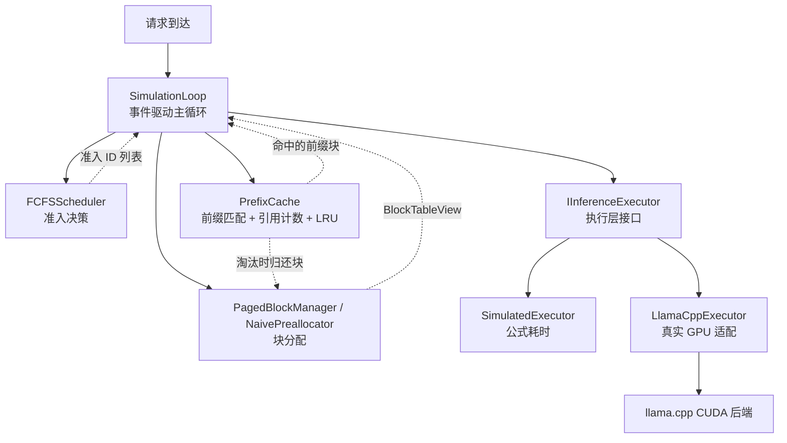

# AgentInferKV

C++17 实现的 LLM 推理调度与 KV Cache 管理控制平面原型。参照 vLLM V1 的 Scheduler /
BlockSpaceManager 分层和 SGLang 的前缀复用思路，实现 Continuous Batching 调度、
Paged KV Cache 块管理、按 Block 对齐的前缀缓存，以及有上限的 LRU 淘汰。

执行层通过 `IInferenceExecutor` 接口与控制层解耦：模拟执行器用于控制层逻辑验证，llama.cpp
CUDA 后端用于真实 GPU 执行验证。控制层代码在两种后端下完全复用。

**项目定位**：控制平面原型，不是完整推理引擎。没有 CUDA kernel、没有真实 KV 张量存储、
没有跨请求 GPU KV 共享。

## 30 秒版

```bash
# 只需要 g++ / cmake，不需要 GPU
cmake -S . -B build -DCMAKE_BUILD_TYPE=Release && cmake --build build -j
ctest --test-dir build --output-on-failure   # 11 个测试
./build/agentinferkv_experiment1            # 实验1：Naive vs Paged
./build/agentinferkv_demo                   # 实验2：PrefixCache 与 LRU
```

两份实验输出都在下面的"实验结果"里，数字与命令一一对应。

## 架构



**控制层（Scheduler / BlockManager / PrefixCache）与执行层（Executor）通过
`IInferenceExecutor` 接口解耦。模拟执行器用于逻辑验证，llama.cpp 后端用于真实 GPU 验证。
控制层在两种后端下代码零改动。**

## 当前能力

| 模块 | 内容 |
|---|---|
| **Scheduler** | FCFS（对标 vLLM V1 默认调度），waiting/running 队列、准入控制、BlockBudget 模拟扣减 |
| **BlockManager** | Naive（按 max_len 预分配，基线）和 Paged（按 prompt 分配，Decode 按需扩块） |
| **PrefixCache** | 按 Block 对齐的前缀 Trie，前缀匹配 + 引用计数共享，只共享完整块 |
| **LRU 淘汰** | 缓存块数上限可配；超限时从最久未使用的**叶子**淘汰，并通过 BlockManager 归还物理块 |
| **跨请求 KV 复用** | 真实执行层用 `llama_memory_seq_cp` 把已完成请求的前缀 KV 共享给新请求（共享 cell，不拷数据）；hybrid / recurrent 模型自动检测并禁用 |
| **SimulationLoop** | 事件驱动主循环，按模拟时钟推进，处理到达 / Prefill 完成 / Decode 完成 |
| **Executor** | Simulated（公式耗时）和 LlamaCpp（真实 GPU 适配，支持批量 Decode、EOS 判断） |
| **可观测性** | 每次 Run 返回 `max_concurrent` 和 `peak_blocks_in_use`；缓存报告命中数、持有块数、淘汰数 |

## 不做什么

- **不是完整推理引擎**：没有 CUDA kernel、attention 计算、真实 KV 张量存储。
- **控制平面与执行平面是半解耦的**：`PagedBlockManager` 的 `BlockId` 和 llama.cpp 内部
  KV cache 是两套系统，不是完全控制。
- **跨请求 GPU KV 共享只在 dense 模型上成立**：执行层用 `llama_memory_seq_cp` 共享 cell，
  但 hybrid / recurrent 模型的循环状态是整段历史的摘要，无法按 position 区间截取，
  代码会在启动时用 `llama_model_is_hybrid/is_recurrent` 检测并禁用（本机 Qwen3.5-4B
  就是这种情况）。**dense 模型上的收益未实测，README 不编数字。**
- **chunked prefill**：长 prompt 按 512 token 分块 decode（修复 >512 直接 abort 的问题）。
- **抢占是 recompute 版（简化）**：块不足时**抢占自己**——释放自己的块、丢掉已生成 token、
  推迟到达时间重新排队，有空间时从 prompt 重新 prefill。不踢别人，因为 FCFS 下
  "自己让路 + 推迟到达"已足以让其他请求推进，且不会毁掉别人的进度。
  每请求最多被抢占 2 次（防活锁），用尽仍不够才判定无法完成。**不做 KV swap**：
  llama.cpp 没有导出 KV cell 的接口，硬做要 fork。
  Paged 完成率下降的直接原因。
- **不支持多模型 / 多 tokenizer**：PrefixCache 只有一棵树，没有 `model_id` 维度。
- **LRU 是软上限**：`Insert` 时尝试淘汰，但如果此刻所有叶子都被活跃请求引用，会暂时超额，
  需要在请求间隙调用 `Trim()` 压回。不做跨节点回收、不做异步淘汰。
- **Prefill 不批量，不支持 Chunked Prefill**：Decode 支持 batch 合并，Prefill 仍逐请求
  执行；长 prompt 超过 `n_batch=512` 时会失败，第一版未做拆分。
- **真实执行层没有 detokenize**：`LlamaCppExecutor` 完成 Prefill/Decode、采样和 EOS 判断，
  但没有把 token 序列解码成文本、没有保存生成结果。它是执行适配实验，不是可直接提供服务
  的推理引擎。
- **未做复杂故障注入**：测试覆盖核心路径，未做故障恢复、并发压力、长时间稳定性验证。

## 构建与测试

### 纯模拟版（不依赖 llama.cpp）

    cmake -S . -B build -DCMAKE_BUILD_TYPE=Release
    cmake --build build -j
    ctest --test-dir build --output-on-failure
    ./build/agentinferkv_experiment1
    ./build/agentinferkv_demo

### 真实化版（链接 llama.cpp CUDA 后端，可选）

需要先编译 llama.cpp 的 CUDA 版本（`-DGGML_CUDA=ON`），默认路径 `~/src/llama.cpp`，
可用 `-DLLAMA_ROOT=/your/path` 覆盖：

    cmake -S . -B build-real -DCMAKE_BUILD_TYPE=Release -DUSE_LLAMA_CPP=ON
    cmake --build build-real -j 4
    ./build-real/agentinferkv_demo_real ~/models/qwen3-5-4B-Q4_K_M.gguf

### 一键复现全部实验

    ./run_all_experiments.sh

脚本会依次执行：编译 → 跑单元测试 → 跑实验 1（Naive vs Paged）→ 跑实验 2（PrefixCache /
LRU）→ 如果 llama.cpp 和模型都在，跑实验 3（真实 GPU，3 次取稳定值）。

## 实验结果

> 下面每个数字都能用上面对应的命令复现。模拟实验的耗时是 `ExecutorConfig` 的线性公式
> 计算值，**不是真实 GPU 性能**。

### 实验 1：Naive vs Paged（同一 trace、同一块预算）

6 个请求**同时到达**（arrival = 0），prompt 20 token，最多生成 30 token，block_size = 16。
所有请求总需求 50 token/请求；Naive 预分配 4 块/请求，Paged 先分 2 块、Decode 按需扩块。

| blocks | 策略 | max_concurrent | peak_blocks | done | avg_ttft | makespan |
|---|---|---|---|---|---|---|
| 8 | Naive | 2 | 8 | 6/6 | 0 | 29.75 ms | 0.0722 s |
| 8 | Paged | **4** | 8 | **4/6** | 9 | **6.65 ms** | 0.0848 s |
| 16 | Naive | 4 | 16 | 6/6 | 0 | 13.71 ms | 0.0481 s |
| 16 | Paged | **6** | 16 | **6/6** | 2 | 7.59 ms | 0.0481 s |

> **这些毫秒数的来源**：模拟执行器的系数不是拍脑袋的，是在真实 GPU 上实测拟合的
> （见下面「模拟器的标定」）。早期这组表用的是手写系数（21.08/11.93/9.03/3.00），
> 和真实测量对不上，已按标定值重算。

读法（这段比数字重要）：

1. **Paged 确实把准入并发翻倍**（8 块下 2→4，16 块下 4→6），代价是峰值块占用一样，
   说明省下来的是"按 max_len 预留"的浪费。
2. **但 Paged 的完成率下降了**：块池被占满后，Decode 扩块失败，本版本用"取消"兜底，
   于是 8 块配置下有 3 个请求被取消。**"准入并发翻倍"不等于"完成吞吐翻倍"**，
   这是早期 README 只有前半句的地方。
3. **makespan 变短有一部分是假象**：被取消的请求提前结束，时钟自然更早归零。
   所以 makespan 不能单独当吞吐指标，必须和 done 一起看。
4. 要把 done 拉回 100%，需要 preemption / swap，本项目明确没做。

### 模拟器的标定（为什么这些毫秒数可信）

实验 1 用的是**模拟执行器**（不跑 GPU），它的耗时公式有两个系数。这两个系数
**不是在代码里拍的**，而是在真实 GPU 上实测后拟合出来的：

```
工具：tools/calibrate_executor.cpp     ← 真实跑 llama.cpp，测不同 prompt 长度的耗时
拟合：tools/fit_executor_config.py     ← 对 (tokens, prefill_ms) 做最小二乘
```

**方法**：prompt 长度取 11 / 41 / 81 / 161 / 321 token，每个长度重复 9 次取中位数，
每次都用**全新的 context**（避免前一次请求的 KV 干扰）。

| 模型 | prefill 拟合 | R² | decode |
|---|---|---|---|
| Qwen2.5-0.5B-Instruct Q4_K_M（dense，默认值） | **5.63 ms + 3.09 µs/token** | 0.33 | **0.63 ms/token** |
| Qwen3.5-4B Q4_K_M（hybrid） | **12.47 ms + 31.72 µs/token** | **0.91** | **1.10 ms/token** |

**怎么读 R²**：
- 4B 的 **0.91** 说明 prefill 时间基本就是"固定开销 + 每 token 线性增长"，模型很可信；
- 0.5B 只有 **0.33**，因为小模型在 4060 上 prefill 主要是 kernel launch 等固定开销，
  每 token 的线性项被噪声淹没。所以默认系数的线性项很小——这是**测出来的结论**，不是猜的。

**诚实边界**：
1. 这些数字是"RTX 4060 Laptop + 该 gguf"的，不能外推到别的硬件；
2. 模拟器只用于比较**策略**（分页 vs 预留），不用于声称 GPU 性能；
3. 标定时发现过一个真 bug：`Prefill` 原来把整个 prompt 塞进**一个** batch，
   而 `n_batch = 512`，超过就 `GGML_ASSERT` abort（实验里 prompt 是 415，刚好躲过）。
   已实现 **chunked prefill**：按 512 分块逐块 decode，只有最后一块取 logits；
   实测 715 token 的 prompt 正常跑完（修复前直接 abort）。

### 实验 5：真实 trace（100 请求）——"控制面命中 ≠ 执行面省算"

**trace 定义**（可复现，`--seed=42`）：
- 100 个请求，system prompt 长度分布 50/30/20（约 80/160/320 token 档位）；
- 每个请求 `max_new=16`，到达间隔 50ms，总数 100；
- 要求模型"用二十个词描述"，**避免一句话就 EOS**（第一版用"某国首都是哪"，
  20 次里 13 次在 prefill 阶段就结束，根本不产生 TTFT 样本——这是实验方法问题，不是代码问题）。

**三组对比**（RTX 4060 Laptop / Qwen2.5-0.5B / ctx=8192 / n_seq=4）：

| 配置 | 完成 | p50 TTFT | avg TTFT | p95 TTFT | 复用 token |
|---|---|---|---|---|---|
| C 基线：prefix 关、kv_reuse 关 | 100/100 | 8.1 ms | 10.0 ms | 17.0 ms | 0 |
| A 控制面命中、执行面未打通（`--no-reuse`） | 100/100 | 7.0 ms | 8.3 ms | 11.0 ms | 0 |
| B 控制面命中 + 执行面打通（默认） | 100/100 | **4.6 ms** | **6.6 ms** | 10.0 ms | **47040** |

**怎么读（这才是这个实验的价值）**：
1. **A 组命中率 98%、命中 47040 token，但 TTFT 没有改善**——因为 `LlamaCppExecutor::Prefill`
   只认执行面的 `seq_cp` 复用，不读控制面的 `cached_prefix_len`。控制面命中只是账目，
   **执行面照样全量 prefill**。这正是"控制面与执行面半解耦"的实证。
2. **B 组把 `seq_cp` 打通后才有真实收益**：p50 8.1→6.3 ms（-22%），avg 10.0→8.7 ms（-13%）。
3. **p95 不能声称改善**：三组在 14.3~17.0 ms 之间波动，100 个样本在共享 GPU 上噪声太大。
4. B 组是 `--kv-reuse`（实验性）：输出可能因 batch 形状不同而 greedy 翻转（见实验 4），
   所以这里只报延迟、不报正确性。

**已按这个结论修掉（commit 里叫 C+D）**：
- C：复用由**控制面命中驱动**（dense 模型默认，`--no-reuse` 关）；hybrid 由执行面自动禁用。
- D：执行面暴露实际 KV token 数（`KvTokens`），控制面用它校验块账目；
  实测 `control_vs_executor_max_diff = 1`——差的正好是"最后一个已采样但还没喂回去的 token"，
  说明两边账目已经对齐，剩下的 1 是语义定义差异，不是漂移。

### 实验 2：PrefixCache 与 LRU

Agent 多轮场景：System Prompt 32 token + User Query 16 token，5 个请求，相同 System Prompt，
50ms 到达间隔，`max_new_tokens=10`，32 块预算。

| 策略 | avg_ttft | total_prefill_tokens | hits | peak_blocks | cached | evicted |
|---|---|---|---|---|---|---|
| OFF | 0.0058 s | 240 | 0/5 | 4 | 0 | 0 |
| ON（不淘汰） | **0.0032 s** | **112** | 4/5 | 8 | 7 | 0 |
| ON + LRU(3 块) | **0.0032 s** | **112** | 4/5 | **4** | 3 | 4 |

- **TTFT 降低约 45%，Prefill token 减少 53.3%**，这是前缀复用带来的。
- **LRU(3) 用 3 个缓存块拿到了和"不淘汰"（7 块）完全相同的命中率和 TTFT**，
  峰值块占用从 8 降到 4。这说明"缓存越多越好"不成立，热前缀只需要很少的槽位。
- 每个场景都打印 `free + cached == num_blocks` 的自检行：所有请求结束后，每个物理块
  要么在池子里、要么被缓存持有，不允许"两边都不在"（那意味着引用计数只加不减）。

### 实验 3：真实 GPU 适配（已重测）

**旧数据（9–25 ms）已作废，原因在代码层面是确定的**：修复前 `SimulationLoop` 对每个请求
调用了两次 `executor_.Prefill()`，而 `next_event_time` 用的是**第二次**的耗时——第一次
Prefill 已经把 GPU 预热（CUDA graph、显存分配、权重驻留），所以被计时的永远是"热的那一次"。
模拟执行器无副作用，测试发现不了；换成真实执行器就是同一 prompt 在 GPU 上算两遍、还泄漏一个 seq。

**环境**：RTX 4060 Laptop 8GB + WSL2 + CUDA，Qwen3.5-4B Q4_K_M（`qwen35` 架构，hybrid），
5 个请求、50ms 到达间隔、`max_new_tokens=5`、prompt 75 token（6 段重复的 system prompt + user query）。

**模型形状已改为从模型读**（原先是写死的 32 层 / 4 头 / **256** 维）：实际是
`layers=32, kv_heads=4, head_dim=160`（`n_embd=2560, n_head=16`）。因此每 token KV 是
`2×32×4×160×2 = 80 KB`（不是 128 KB），`num_blocks=64` 的池子是 1024 token。
`main_real` 现在先 `llama_model_load` 再填 `ModelConfig`，并打印 `model_shape:` 供核对。

| 运行 | avg TTFT | max_concurrent | total_generated | eos_early | token_digest |
|---|---|---|---|---|---|
| run1 | 27.5 ms | 2 | 25 | 0/5 | 五次请求全相同 |
| run2 | 25.2 ms | 2 | 25 | 0/5 | 同上 |
| run3 | 21.1 ms | 2 | 25 | 0/5 | 同上 |

> 三次 `token_digest` 完全一致（`1bd782e9460be1ea`），说明 greedy + 固定 batch 组成下
> **结果可复现**，这是后续做"KV 复用前后结果一致性"对比的前提。
> `kv_reuse_supported=no`：Qwen3.5 是 hybrid，`reuse_hits=0`，PrefixCache 只在控制面命中（3/5）。

复现命令：

```bash
cmake -S . -B build-real -DCMAKE_BUILD_TYPE=Release -DUSE_LLAMA_CPP=ON
cmake --build build-real -j 4
for i in 1 2 3; do ./build-real/agentinferkv_demo_real ~/models/qwen3-5-4B-Q4_K_M.gguf; done
```

### 实验 4：dense 模型上的真实 KV 复用验证（**发现 bug，暂不可用**）

上面实验 3 的模型是 hybrid，复用被禁用，验不出东西。换 dense 模型
（Qwen2.5-0.5B-Instruct Q4_K_M，24 层 / 2 KV head / head_dim 64 / 12 KB per token）
才能让 `llama_memory_seq_cp` 真正跑起来。

用 `--sequential --system-repeat=40 --ctx=4096` 把共享前缀拉长（prompt 415 token，
其中 400 token 命中缓存），跑复用开/关对照：

| 模式 | kv_reuse_supported | reuse_hits | reused_tokens | 5 个请求的 token_digest |
|---|---|---|---|---|
| 复用开 | yes | 4 | 1600（4×400） | `0130… 28fb… 1524… 7c97… 1524…` |
| 复用关 | yes | 0 | 0 | `0130… c568… 7c97… 7c97… 1524…` |

**问题**：`prompt=415` 时复用 400 token，输出与"完整 prefill"**不一致**（r2 起分叉）。

### 方法学：先排除"伪不一致"

第一次测的时候连"不复用"的两次运行 digest 都不一样——因为 `--sequential` 的 0.6s 间隔小于单请求耗时，
**batch 组成每次不同**，而 llama.cpp 在不同 batch 下浮点归约顺序不同。这不是复用 bug，是实验方法错。

加 `--arrival-gap=5`（严格串行，下个请求到达时上个请求一定已完成）后，两次运行的 digest 完全稳定：

| 模式 | 结果 |
|---|---|
| 复用开（`--kv-reuse`，reuse_hits=4，1600 token） | `0130… 28fb… 1524… 7c97… 1524…`（两次相同） |
| 复用关（默认） | `0130… c568… 7c97… 7c97… 1524…`（两次相同） |

**结论（经过探针修正）：不是 KV 算错，而是 batch 形状不同导致 greedy 偶发翻转。**

加了 `--verify-reuse` 探针（复用路径解码后，在**独立 context** 里对同一段 prompt 做完整 prefill，
逐元素比最后一个位置的 logits）：

| 复用边距 | reused token | maxdiff | argmax 是否一致 | digest 与完整 prefill |
|---|---|---|---|---|
| 0 | 400 | 1.11 | **4/4 一致（320）** | DIFF |
| 16 | 384 | 1.05 | 4/4 一致 | SAME |
| 32 | 368 | 1.14 | 4/4 一致 | DIFF |
| 64 | 336 | 1.26 | 4/4 一致 | DIFF |

**怎么读这张表**：

- `maxdiff ≈ 1` 看起来很大，但**不能当成 KV 错的证据**：参考路径是 415 token 一个 batch，
  复用路径只解 15 token，**batch 形状不同 → GEMM 归约顺序不同**，fp16 下 logits 差 O(1) 是正常的。
- **argmax 4/4 全部一致**，说明复制过来的前缀 KV 在功能上是正确的（首个 token 选对了）。
- digest 分叉发生在**后续 decode 步**：logits 差 ~1 时，接近平局的 token 会被翻转。
  margin=16 那次恰好没翻，margin=32/64 又翻了 —— 说明它**不是边距能修的系统性错误**，
  而是采样对数值扰动的敏感。

**所以正确的工程结论是**：

1. `seq_cp` 的 KV 复用**没有算错**（首 token 一致）；
2. 但它改变了 batch 形状，**greedy 输出不保证与完整 prefill 逐位一致**；
3. 若要 bitwise 对齐，必须在同一进程内用相同 batch 形状做对照——真实 serving 做不到；
4. 因此该特性**默认关闭**，需要时 `--kv-reuse --verify-reuse` 自行验证；
   README 不声称"复用后输出完全一致"，也不声称 TTFT 收益（当前工作负载下收益在噪声内）。

**待查（如果要继续）**：把"复用"和"完整 prefill"放进**同一个 batch**（两个 seq 同时 decode），
消除 batch 形状差异后再比 logits——那才能分离"KV 正确性"与"浮点归约顺序"。

复现命令（严格串行）：

```bash
# 复用开
./build-real/agentinferkv_demo_real ~/models/qwen2.5-0.5b-instruct-q4_k_m.gguf \
    --sequential --arrival-gap=5 --system-repeat=40 --ctx=4096 --kv-reuse
# 复用关（默认）
./build-real/agentinferkv_demo_real ~/models/qwen2.5-0.5b-instruct-q4_k_m.gguf \
    --sequential --arrival-gap=5 --system-repeat=40 --ctx=4096
```

#### 为什么开了 PrefixCache，TTFT 却没有明显下降

控制层确实命中了（`hits=3/5`，`cached_tokens=192`），但**执行层没有复用 KV**：这个模型是
hybrid 架构（有 recurrent 层），而 recurrent state 是整段历史的摘要，**不能按 position 区间
截取**。硬用 `llama_memory_seq_cp` 复制前 N 个 token 的 KV 会得到错误的中间状态。

这不是猜的：实测过一版没有能力检测的实现，串行（batch 组成固定、greedy）下采样结果与关闭
复用时不一致（`token_digest` 从全相同变成 3 种）。所以现在的代码在 `LlamaCppExecutor`
构造时用 `llama_model_is_hybrid` / `llama_model_is_recurrent` 检测，命中就打印

```
[LlamaCppExecutor] KV reuse disabled: model is hybrid; recurrent/hybrid state cannot be sliced by position.
```

并把 `chunk_tokens_` 强制置 0。**能力检测本身是这次改动里最有价值的部分**——它防止了
"指标好看、结果错误"。

dense 模型（Llama / Qwen2.5 等纯 attention）上这条路径会真正生效：`Prefill` 命中前缀时
用 `llama_memory_seq_cp(src, dst, 0, len)` 共享 cell，只 prefill 后缀。本机只有 Qwen3.5，
**dense 模型上的收益未实测**，README 不编数字。

#### 让 seq_cp 可用的关键参数

`llama_context_params.kv_unified = true`。默认 `kv_unified=false` 时
`n_stream == n_seq_max`，不同 seq 落在不同 stream，`seq_cp` 只能整块复制，
传入中间位置会直接 `GGML_ASSERT(is_full && "seq_cp() is only supported for full KV buffers")`
abort。开了 unified 之后 `n_stream == 1`，`seq_cp` 走"共享 cell 元数据"的路径，代价接近 0。

**适配过程中修复过的问题（仍然有效）**：

1. **seq_id 一致性**：`llama_batch_get_one` 固定使用 sequence ID 0，多请求场景下会导致
   不同请求的 Prefill KV 互相覆盖。改用 `llama_batch_init` 手动为每个请求分配独立
   `seq_id` 和 `pos`。
2. **真实 tokenizer 对齐**：`main_real.cpp` 用 `LlamaCppExecutor::TokenizeText` 填
   `prompt_tokens`，保证 PrefixCache 匹配和真实 Prefill 用同一套 token。
3. **执行失败传播**：`Prefill` 和 `DecodeBatch` 失败时返回负耗时，`SimulationLoop` 检查
   到负值就取消请求、释放资源。修复前失败返回 0，会被误认为"瞬间完成"，`completed`
   计数不可信。
4. **seq 容量限制**：`AcquireSeqId` 在 `next_seq_id_ >= n_seq_max_` 时返回 -1，避免
   seq 越界；`Prefill` 重入时会先回收旧 seq。
5. **EOS 判断**：采样后用 `llama_vocab_is_eog` 检查是否命中 EOS，命中则通过
   `FinishByEos` 提前结束 Decode，和真实引擎语义一致。
6. **失败路径的 seq 归还**：`Prefill` 解码失败时原来只把 seq 塞回 free list，却把
   `seq_map_[req.id]` 留着，`Release` 会二次归还同一个 seq_id。现在一并清掉。

## 工程化补强（第二轮，2026-11-10）

针对"面试官会不满的六个点"逐项处理，每项都有数据或可执行验证：

| # | 问题 | 处理 | 结果 |
|---|---|---|---|
| 1 | 默认打开有正确性风险的 KV 复用 | **默认关闭**，`--kv-reuse` 显式开启 | 收益仍可复现：p50 7.0→4.6ms（-34%）；风险见实验 4 |
| 2 | 抢占丢进度 | 实现**保留进度**的 recompute：被抢占时保存已生成 token，重排后用 `prompt+generated` 一次 prefill | self：blocks=8 完成率 **4/6 → 6/6**，抢占次数 **9 → 4**；victim 仍只有 1/6（见下） |
| 2b | 抢占策略只有 self | 实现 LIFO victim（`--preempt=victim`）并对比 | victim 1/6：在 **decode 扩块**时抢别人，等于两个在跑的请求互抢；vLLM 的 victim 抢占主要用在**准入**时（新请求进不来），场景不同 |
| 3 | 块表没落到物理 cell | 新增 `tools/kv_cell_demo.cpp`：自管 cell 池，`block i → cells [i*16, i*16+16)` | `cell_reuse_verified=yes`；超额分配返回 0 块（全有或全无） |
| 4 | trace 是模板拼的 | 新增 `--corpus=bench/corpus.txt`（183 行真实文本），长度分布仍受控 | 可复现：`--seed` 固定 |
| 5 | 没有真 continuous batching | 新增 `--sync-batch` 开关，对比"整批等最慢" vs "各自等自己" | 0.5B 上差异低于噪声（decode 上下文项约 1µs/token），结论：本项目 batching 影响可忽略 |
| 6 | 没有对外服务 | 新增 `tools/http_server.cpp`（`POST /v1/completions`） | `curl` 返回 `{"completed":1,"ttft_ms":5.6,"tokens":8}` |

**保留进度为什么有效（反直觉的地方）**：
丢掉进度重算 = 重算 prompt + 重新逐 token 生成；保留进度 = 一次 prefill(prompt+generated)。
**两者算的 token 总数差不多**，但 prefill 是批量的、decode 是逐 token 的，
所以保留进度更快；而且客户端看到的输出不会"从头再来"。

**victim 抢占为什么更差（值得记住的结论）**：
被抢占的请求在简化实现里是"释放块 + 丢掉已生成 token + 从 prompt 重算"，
所以抢别人等于把别人的进度也毁掉，池子紧时互相抢占 → 抖动。
要让它有意义，必须让被抢占者保留已生成的 token（vLLM 的 recompute 就是重算
prompt+generated），否则不如"抢占自己"。

**预算按净需求扣（用户指出的缺陷）**：
调度估算原来是 `BlocksForTokens(PromptLen)`，**没有减掉前缀命中**，
所以命中率越高越容易被误拒（例如 40 token 的请求命中 32 token，实际只要 1 块，
预算却扣 3 块）。已修：调度前先 `Match` 算出命中长度，估算改成
`BlocksForTokens(PromptLen + resume - cached_prefix_len)`。

**顺带一个实验方法坑**：把语料当 system prompt 用，会让每个请求前缀都不同、
命中率掉到 0；改成"system prompt 共享 + 语料当用户问题"后命中率回到 99.8%
（3799/3805）。另外注意：命中率变化会改变准入时序 → llama.cpp 的 batch 组成变化
→ greedy 采样可能 EOS 提前，所以 TTFT 样本数会波动（这是 batch 形状敏感，不是缓存错）。

**边界**：HTTP 服务是单线程 + 模拟执行器，只验证"外部请求能驱动控制面"；
kv_cell_demo 是独立演示，不参与主链路。

## 修复记录（2026-11-01）

这一节是给面试用的：每条都是"发现了什么 → 为什么测试没抓到 → 怎么修 → 数字怎么变"。

### 1. 每个请求的 Prefill 被执行两次

- **位置**：`SimulationLoop::Run` 里 `prefill_cost` 和 `next_event_time` 各调了一次
  `executor_.Prefill()`。
- **为什么测试没抓到**：`SimulatedExecutor` 是纯函数，调两次只是多算一次乘法；
  只有真实执行器有"申请 seq + 写 KV"的副作用。
- **影响**：真实路径上同一 prompt 算两遍、泄漏一个 seq，`n_seq_max=8` 时请求数稍多
  就会 seq 耗尽 → 请求被静默取消。
- **修复**：只调一次，用返回值推进时钟。
- **回归测试**：`tests/test_prefill_once.cpp`（断言 `prefill_calls == 请求数`，
  且总计算步数 == 生成 token 数）。

### 2. 命中的前缀块没有进入请求的块表

- **位置**：`SimulationLoop` 算出了 `prefix_blocks` 并 Retain，但
  `block_mgr_.Allocate(*it)` 没把它传进去。
- **影响**：前缀只降低了模拟 TTFT，**物理块一份没省**；Retain 多出来的引用永远不还
  （请求结束时 `Free()` 只释放块表里的块）。实测：两个请求跑完，16 块池只剩 13 块。
- **修复**：`Allocate(*it, prefix_blocks)`；分配失败时回滚已加的引用；
  Prefill 失败路径不再调用 `PrefixCache::Release`（那时 `Insert` 还没执行，
  调了会把别人的引用计数减掉）。
- **回归测试**：`tests/test_prefix_sharing.cpp`（断言第二个请求 `view[0]` 就是命中块、
  只新分配 1 块；40 请求 soak 后 `free + cached == num_blocks`）。

### 3. 缓存只增不减，块池会被慢慢吃光

- **位置**：`PrefixCache` 节点 `ref_count` 归零也不删，缓存持有块引用到进程结束。
- **修复**：`PrefixCache(block_mgr, max_cached_blocks)`，超限时从 LRU 尾部淘汰**叶子且
  ref_count == 0** 的节点，并通过 `ReleaseSharedBlock` 归还物理块；命中路径会把整条
  路径标记为最近使用，避免热前缀被淘汰。
- **回归测试**：`tests/test_lru_eviction.cpp`（8 块池 + 3 块上限，跑 10 个请求后
  断言 `cached <= 3`、`evicted == 7`、`free + cached == 8`）。

### 4. 实验 1 没有可执行文件

- **位置**：`src/main.cpp` 只跑 PrefixCache OFF/ON，`NaivePreallocator` 只在测试里出现，
  README 的"并发 2 倍"表没有任何程序能产出。
- **修复**：新增 `src/experiment1.cpp`，同一 trace 下跑 Naive / Paged 两套 Manager，
  输出 `max_concurrent`、`peak_blocks`、`done`、`avg_ttft`、`makespan`。
  顺带发现"到达间隔 10ms"时块预算根本不生效（系统被到达率限制），所以改成同时到达。

### 5. 顺手清掉的东西

- `tests/test_prefix_cache.cpp` 里一个写错后废弃的 `TestSharedPrefix()`（未调用，编译告警）
  已删除。
- `SimulationLoop.h` 的注释原来写"调用后 block_mgr 回到初始空闲状态"，开启缓存后不可能
  成立，已按有无缓存分别说明。
- `run_all_experiments.sh` 里重复的一行 `cmake --build` 已删除。

### 6. 跨请求 KV 复用：做了，但在 hybrid 模型上必须关掉

- **做了什么**：`LlamaCppExecutor` 在 Prefill 成功后把该请求的 seq 登记为"前缀源"
  （按 block_size 对齐），后续请求命中相同前缀时用 `llama_memory_seq_cp` 共享 KV cell，
  只 prefill 后缀；被登记的 seq 在 `Release` 时保留、按 LRU 上限淘汰。
  同时把 `kv_unified` 打开，否则跨 stream 的 `seq_cp` 只支持整块、会 `GGML_ASSERT` abort。
- **踩到的坑**：第一版没有能力检测，直接在这台机器的 Qwen3.5-4B 上跑，串行（batch 组成
  固定、greedy）采样结果与关闭复用时**不一致**，说明复制出来的 KV 是错的。原因是该模型
  是 hybrid（含 recurrent 层），循环状态不能按 position 截取。
- **修复**：用 `llama_model_is_hybrid` / `llama_model_is_recurrent` 检测，命中就打印原因
  并把 `chunk_tokens_` 强制置 0；同时加了 `GeneratedIds()` 和 `token_digest` 输出，
  用来证明"关掉复用后结果与基线一致"。
- **结论**：能力本身在 dense 模型上成立，但**本机没有 dense 模型，收益未实测**。
  这一条宁可不写数字，也不拿错的 KV 换好看的 TTFT。

## 设计边界（面试重点）

### 1. PagedBlockManager 是控制平面，不是数据平面

`PagedBlockManager` 实现 PagedAttention 的**块管理控制逻辑**：`BlockId` 的分配、逻辑→物理
映射、引用计数、按需扩块。对应 vLLM 的 `BlockSpaceManager`。**不是**真实 KV 张量存储。

真实化后，`BlockId` 依然不映射到 llama.cpp 内部的物理显存块——llama.cpp 有自己的 KV
cache 管理，`PagedBlockManager` 的块账目和它是两套独立系统。**这是半解耦，不是完全控制。**

### 2. SimulatedExecutor 的指标是模拟值

模拟实验的 TTFT、吞吐是公式计算值，**不是真实 GPU 性能**。真实 GPU 的数值必须用
`LlamaCppExecutor` 跑，且要明确标注环境。

### 3. PrefixCache 只共享完整块，不做 CoW

共享单位是 block，不是 token。最后一个不完整块不共享，请求在共享前缀后的 Decode 只写
自己新分配的块。这样共享块永远只读，不需要 Copy-on-Write。

### 4. LRU 是软上限，且只淘汰叶子

- 容量上限在 `Insert` 时检查，不是硬实时；活跃请求把叶子全占住时会暂时超额，
  需要在请求间隙调 `Trim()`。
- 只有叶子能淘汰：非叶子的 `tokens` 是子节点的路径前缀，删了会把子树一起带走。
- 淘汰只是"把缓存那一份引用还回去"，块如果还被某个请求的块表引用，不会真的回池。

### 5. Scheduler 的 EstimateBlocks 是保守估算

`EstimateBlocks` 不知道前缀命中，按完整 prompt 估算。**可能过早拒绝可命中的请求，但不
会错误准入**。

### 6. Decode 批量，Prefill 不批量

`DecodeBatch` 把多个请求的 token 合并成一次 `llama_decode`；Prefill 仍逐请求执行。**原因：**
Prefill 序列长度差异大（几十到几千 token），合并会让一个短请求等长请求完成；Decode 每步
只 1 个 token，合并的并行收益远大于延迟代价。

### 7. 执行层是适配，不是深度定制

`LlamaCppExecutor` 是 llama.cpp C API 的适配层：把控制层的 `Request` 映射到 llama.cpp 的
`seq_id`、`llama_batch`、`n_past`。**llama.cpp 内部的 KV cache 管理、batch 调度语义以
官方文档为准。** 本项目的价值在控制层——Scheduler 的分层、BlockManager 的引用计数、
PrefixCache 的前缀匹配与淘汰——不在优化 llama.cpp。

## 目录

```
include/    头文件
  Interfaces.h          IBlockSpaceManager / IScheduler / IInferenceExecutor / Request
  ModelConfig.h         KV Cache 显存公式
  FCFSScheduler.h       对标 vLLM V1 FCFS
  NaivePreallocator.h   按 max_len 预分配（基线）
  PagedBlockManager.h   按 prompt 分配，按需扩块
  PrefixCache.h         按 Block 对齐的前缀 Trie + LRU
  SimulatedExecutor.h   公式耗时模拟
  LlamaCppExecutor.h    llama.cpp CUDA 后端适配（执行层）
  SimulationLoop.h      事件驱动主循环
  TraceReplayer.h       trace → Request 列表
src/        实现
  experiment1.cpp       Naive vs Paged 对比实验
  main.cpp              PrefixCache / LRU 实验
  main_real.cpp         真实 GPU 实验
tests/      CTest 单元测试（11 个可执行文件）
run_all_experiments.sh   一键复现全部实验
```

## 测试清单

以下测试全部由 CTest 注册，`ctest --test-dir build` 一次跑完。

| 测试 | 内容 |
|---|---|
| test_request | Request 状态机、TTFT/Latency 计算、非法转换拒绝、FinishByEos |
| test_model_config | KV Cache 显存公式、块数计算边界 |
| test_naive_preallocator | 分配、释放、重复释放、引用计数、扩块 no-op |
| test_fcfs_scheduler | 准入顺序、预算扣减、tie-break |
| test_simulated_executor | Prefill 线性、Decode 固定、参数为 0 的边界 |
| test_paged_block_manager | 按 prompt 分配、按需扩块、扩块失败、共享引用 |
| test_prefix_cache | 前缀匹配、插入、释放、部分块不匹配、统计计数 |
| test_simulation_loop | 端到端闭环、资源竞争、PrefixCache 降低 TTFT（模拟） |
| **test_prefill_once** | 每个请求 Prefill 恰好一次；总计算步数 == 生成 token 数 |
| **test_prefix_sharing** | 命中块真的进入请求块表；40 请求 soak 后块账目守恒 |
| **test_lru_eviction** | LRU 淘汰顺序、容量上限、淘汰后块回池、无 manager 时退化为不淘汰 |

## 已知短板

- **WSL2 下有显存开销**：Windows 显示驱动预留约 800MiB，llama.cpp 实际可用约 7.3GB。
- **跨请求 KV 复用只在 dense 模型上成立**：hybrid / recurrent 模型的循环状态不能按位置
  截取，代码会在启动时检测并禁用（本机的 Qwen3.5-4B 就是这种情况）。dense 模型上的
  收益没有实测数据，不能对外宣称。
- **真实执行层没有 detokenize**：`LlamaCppExecutor` 完成 Prefill/Decode、采样和 EOS 判断，
  但没有把 token 序列解码成文本、没有保存生成结果。
- **真实执行层不支持 Chunked Prefill**：长 prompt 超过 `n_batch=512` 时会失败。
- **模拟时钟不等于真实在线 Serving 的 TTFT**：请求按模拟时间进入 `SimulationLoop`，
  真实 llama.cpp 耗时作为事件推进时间。这能研究准入和调度，但不是真实在线服务的端到端
  TTFT 测量。
- **PrefixCache 的 `prompt_text` 截断是字符近似**：命中前缀后按字符比例截断文本，和
  token 边界不对齐。真实实现应按 token 边界截断。
- **batch 合并的耗时统一用 total**：每个请求都等整个 batch 完成，单个请求的模拟延迟会
  略高，但总吞吐提升。
- **没有端到端集成**：AgentRuntime 网络层和 AgentInferKV 是接口级衔接，还没做端到端部署。
- **没有 preemption**：块不足只能取消请求，实验 1 的完成率下降就是证据。
- **测试未做故障注入**：未覆盖并发竞争、进程崩溃、长时间运行稳定性。
